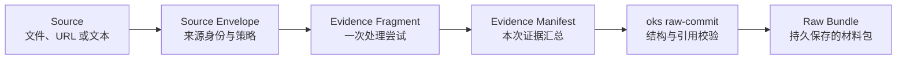

# 协议对象与状态

本页解释 Source Envelope、Evidence Fragment、Evidence Manifest 和 Raw Bundle 的职责。字段约束以当前安装包中的 JSON Schema 为准，可以用 `oks schema show <document-kind>` 查看。

## 对象关系



一个 Source 对应一个 Source Envelope。一次收录可以有多个 Fragment，Manifest 引用并汇总这些 Fragment。`raw-commit` 校验后生成一个 Raw Bundle。

## Source Envelope

文件位置：`manifest/source-envelope.json`

Source Envelope 说明来源是什么、怎样访问、何时取得，以及允许怎样处理。`oks ingest prepare` 会生成这些字段。

| 字段 | 含义 |
|---|---|
| `source_id` | 本次来源的标识，Manifest 必须引用同一个值 |
| `source_uri` | 文件路径、URL 或其他来源位置 |
| `source_modality` | `text`、`web`、`pdf`、`office`、`image`、`audio` 或 `video` |
| `access_mode` | 本地文件、公开 URL、认证来源、用户浏览器或手工提供 |
| `captured_at` | 取得来源的 UTC 时间 |
| `captured_by` | 执行收录的 runtime、model 和 Skill 信息 |
| `content_hash` | 来源内容或来源标识的 SHA-256，用于完整性和去重线索 |
| `policy` | 是否允许远程处理，以及内容敏感级别 |

`content_hash` 相同可以帮助发现重复来源，但不能证明两份材料来自独立渠道，也不能证明其中的说法正确。

## Evidence Fragment

文件位置：`manifest/fragments/<fragment_id>.json`

一个 Fragment 记录一次 Provider、工具或人工处理尝试。多种工具处理同一来源时，应分别记录，不能把失败步骤从历史中删掉。

### Producer

`producer` 包含：

| 字段 | 含义 | 示例 |
|---|---|---|
| `runtime` | 编排本次处理的运行环境 | `oks`、`codex` |
| `provider` | 注册 Provider ID 或保留类型 | `firecrawl`、`runtime-tool`、`agent-runtime`、`human` |
| `tool` | 实际使用的工具 | `firecrawl`、`curl`、`agent-runtime` |

实际使用 `curl` 时，Provider 应写成 `runtime-tool`，工具写成 `curl`。不能为了让记录看起来完整而填入没有运行的注册 Provider。

### Fragment 状态

| 状态 | 含义 |
|---|---|
| `succeeded` | 这次尝试取得了计划中的结果 |
| `partial` | 取得了部分结果，同时保留缺失和警告 |
| `failed` | 这次尝试失败；Fragment 不应包含伪造的 Evidence |

Fragment 没有 `degraded`、`skipped` 或 `pending` 状态。它们属于其他层，或只是提交前骨架中的临时值。

### Artifact 与 Evidence

Artifact 是实际文件，包含 `artifact_id`、类型、相对路径和 SHA-256。Evidence Record 指向一个 Artifact，并说明证据位于哪里、怎样取得，以及文本是否经过 Agent 处理。

| Evidence 字段 | 含义 |
|---|---|
| `evidence_id` | 证据标识 |
| `artifact_id` | 对应 Artifact |
| `kind` | 文本、结构、OCR、截图、转写等证据类型 |
| `method` | 取得证据的方法 |
| `locator` | 页码、时间戳、区域、DOM 或文档级位置 |
| `text` | 可查询的证据文本，可以为空 |
| `confidence` | 对这次提取质量的记录，不是来源主张的正确率 |
| `agent_judgment` | 内容属于机械处理、Agent 处理还是人提供 |

`agent_judgment` 的取值：

| 值 | 何时使用 |
|---|---|
| `mechanical` | 字段提取、编码转换、换行规范化或脱敏，没有语义改写 |
| `agent_observed` | Agent 做了总结、翻译、重排、注释或合并 |
| `human_supplied` | 内容由人直接提供 |

Agent 改写过文本后，不能继续把它描述为某个 Provider 的原始机械输出。原始输出应保存在 `work/<provider>/output.*`，改写结果另作 Evidence。

## Evidence Manifest

文件位置：`manifest/evidence-manifest.json`

Manifest 是本次收录准备提交的证据汇总。它引用 Fragment 和 Artifact，列出实际采用的 Evidence，并记录每项处理能力的结果。

### 总体状态

| 状态 | 含义 |
|---|---|
| `complete` | Recipe 的 `complete_when` 条件已满足 |
| `partial` | 已保存可用证据，但仍缺少 Recipe 要求的部分 |

Manifest 没有 `failed`。如果所有处理尝试都失败，没有可提交的 Evidence，就不应提交 Manifest。`partial` 应在 `warnings` 中说明证据缺口，并且必须提供非 `none` 的 `failure_disposition`，说明下一步需要授权、用户操作、重试，还是已经达到当前条件下的最终结果。当前 `raw-commit` 会强制检查 `failure_disposition`；`warnings` 用于保留具体缺失信息。

`complete` 不表示所有工具都成功。例如视频来源的平台字幕失败，但 ASR 已取得可用转写，仍可能满足 `subtitles_or_transcript_available`。判断依据是 Recipe 的完成条件，不是成功步骤的数量。

### 步骤状态

Manifest 的 `steps[]` 记录每项能力和 Provider 的实际结果：

| 状态 | 含义 |
|---|---|
| `succeeded` | 按计划取得结果 |
| `partial` | 取得部分结果 |
| `degraded` | 使用了降级方法并取得结果 |
| `failed` | 尝试失败 |
| `skipped` | 明确跳过，并应给出原因 |

步骤为 `succeeded`、`partial` 或 `degraded` 时，除 `agent-runtime` 和 `human` 外，都要在 `.oks/runs/<run_id>/work/<provider>/` 保存非空的 `output.*`。这项要求包括注册 Provider、`runtime-tool` 和 `text-read`。

### Modality 状态

`modalities` 按文本、图像、版面、语音或视频记录证据数量，状态可以是 `succeeded`、`partial`、`failed` 或 `skipped`。它描述某种材料形式的处理结果，不等于 Manifest 总体状态。

## Raw Bundle

`oks raw-commit` 通过校验后生成 Raw Bundle。典型目录如下：

```text
raw/<date>/<source>/<bundle>/
├── raw.md
├── bundle.json
├── source-envelope.json
├── evidence-manifest.json
├── content.md
├── evidence.jsonl
├── quality-report.json
├── processing-runs.jsonl
├── source/
├── assets/
└── derived/
    └── fragments/
```

`source/` 保存主要来源 Artifact，`derived/` 保存 OCR、截图、转写和 Fragment 快照等派生内容。`content.md` 是便于阅读和查询的正文入口，不能替代原始文件。

Raw Bundle 的 `processing_status` 沿用 Manifest 的 `complete` 或 `partial`。Raw Bundle Schema 也允许 `failed`，但当前 `raw-commit` 只在存在可提交 Manifest 时组装 Bundle；整次收录失败通常应保留运行错误，而不是伪造一个成功提交的失败 Bundle。

## `raw-commit` 检查什么

CLI 会检查：

- JSON 是否符合对应 Schema；
- Envelope 与 Manifest 的 `source_id` 是否一致；
- Fragment 引用和核心 Evidence 字段是否一致；
- Artifact 是否位于允许目录，文件是否存在，哈希是否匹配；
- Evidence 是否引用已声明的 Artifact；
- Locator 是否符合格式；
- modality 的 Evidence 数量是否与实际记录一致；
- 已执行步骤是否留下可验证的工具原始输出。

这些检查能发现协议、文件和引用错误，不能验证来源说法、OCR 文字或 Agent 总结是否正确。Agent 仍要抽查提取结果；需要长期使用的内容仍要另建 Candidate，由人审核。
