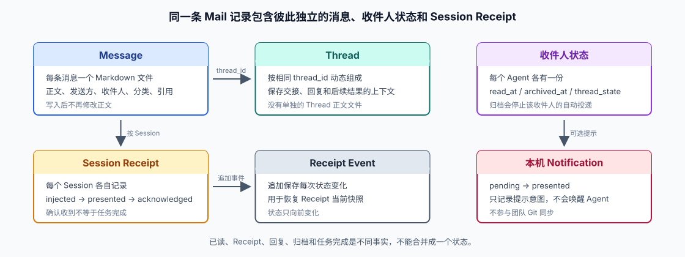

# Mail 协议

OKS Mail 是一套基于文件的协作记录。它解决的问题很具体：一项工作跨越多个 Session、Agent、宿主或机器后，仍能查到谁发送了什么、消息属于哪个 Thread、哪些 Session 接收过，以及后续有没有回复。

Mail 没有中心消息服务，也不负责启动 Agent。它适合保存交接、结果、阻塞、审核请求、批注和对 OKS 产物的引用。任务状态、知识审核和执行过程分别由任务、Candidate、Wiki 与 Trace 管理。

<figure>
  
</figure>

## 数据怎样保存

| 对象 | 表示什么 | 保存位置 |
|---|---|---|
| Message | 一次已经写入的消息，保存发送方、收件人、正文、时间、分类和引用 | `mail/messages/<message-id>.md` |
| Thread | 具有相同 `thread_id` 的一组 Message | 读取时动态组成，没有单独的 Thread 正文文件 |
| 收件人状态 | 某个 Agent 对一条 Message 的已读、归档和 Thread 状态 | `mail/inbox/<agent>/<message-id>.json` |
| Session Receipt | 某条 Message 是否进入、呈现给或被某个 Session 确认 | `mail/receipts/<session>/<message-id>.json` |
| Receipt Event | Receipt 每次向前变化的追加记录 | `mail/receipt-events/<session>/<message-id>/` |
| Session Registry | 已登记的 Agent Session、机器、工作目录和范围 | `mail/sessions/<session-id>.json` |
| Notification | 本机对某个 Agent 的提示意图 | `mail/notifications/<agent>/<message-id>.json` |

Message 正文写入后不再修改。已读和归档属于收件人，Receipt 属于具体 Session。一个 Message 因而可以让不同 Agent、不同 Session 保留各自状态，同时保持原消息不变。

Receipt Event 是状态变化的事实记录，Receipt 文件是便于读取的当前快照。快照丢失时，当前实现可以根据 Event 重建 Receipt。

## 一条消息怎样流转

1. 发送方用 `send`、`delegate` 或 `reply` 写入 Message。系统同时为每个收件人创建独立的收件人状态。
2. 接收方的宿主 Hook 或 `oks mail wait` 找到尚未归档、且当前 Session 没有 Receipt 的 Message。
3. 宿主自动协作记录可以先写入 `injected`；Hook 或 `mail wait` 实际把消息交给 Session 时写入 `presented`。
4. 接收方运行 `oks mail ack` 后，Receipt 进入 `acknowledged`。
5. Agent 核对文件和运行结果，执行任务，再在原 Thread 中回复结果、阻塞或待确认事项。
6. 收件人可以标记已读或归档。归档后，这些 Message 不再自动投递给该收件人，但文件仍然保留，其他收件人也不受影响。

`delegate` 只是把任务、上下文和验收条件整理为一条 `handoff` Message。它不会建立另一套任务存储，也不会启动接收方 Agent。

## 状态不能混用

| 观察到的状态 | 能说明什么 | 不能说明什么 |
|---|---|---|
| Message 已保存 | 发送方已经写入消息文件 | 接收方已经看到或执行 |
| `read_at` | 该收件人把消息标为已读 | 某个 Session 已接收、确认或开始任务 |
| Receipt 为 `injected` | 宿主记录内容已进入该 Session 的上下文 | 内容已经显示给 Agent，或 Agent 已理解 |
| Receipt 为 `presented` | Hook 或 `mail wait` 已把消息提供给该 Session | Agent 已接受任务或开始执行 |
| Receipt 为 `acknowledged` | 该 Session 明确确认收到 | 任务已经完成或结果已经通过验收 |
| Thread 中有回复 | 对方写入了后续 Message | 回复正确，或任务已经完成 |
| `archived_at` | 该收件人归档了这条 Message；按 Thread 归档时，命令会更新当时可见的每条 Message | 原 Message 被删除，其他收件人也已归档，或该 Thread 的未来回复会自动归档 |
| Notification 为 `pending` | 本机记录了提示意图 | Agent 已被唤醒 |
| Notification 为 `presented` | 某个 Session 呈现消息后关闭了提示意图 | 该 Session 已确认或完成任务 |

Receipt 的完整顺序是：

```text
injected -> presented -> acknowledged
```

有些消息会直接从 `presented` 开始。Receipt 只向前变化，重复 `ack` 不会重写首次确认时间。

当前 Hook 和 `mail wait` 用 Receipt 是否存在来避免同一 Session 重复接收。只要该 Session 已有 `injected`、`presented` 或 `acknowledged` Receipt，就不会再次自动投递。新的 Session 仍可接收同一条未归档 Message。

`read_at` 不会阻止新的具名 Session 接收消息，`archived_at` 才会。取消归档不会清除已有 Receipt，也不会重置 `read_at`，所以原 Session 不会因此自动收到第二次。

## Message 的内容分类

`record_kind` 说明这条 Message 记录的是什么。它不是任务状态。

| 值 | 含义 |
|---|---|
| `message` | 普通消息 |
| `goal` | 目标或范围说明 |
| `handoff` | 工作交接 |
| `result` | 返回的结果，仍需按任务要求核对 |
| `blocked` | 阻塞和所需条件 |
| `note` | 补充说明或批注 |
| `knowledge_ref` | 主要用于引用知识或其他 OKS 产物 |
| `review_request` | 请求审核 |
| `acknowledgement` | 通过 Message 表达的确认，不等于 Session Receipt 的 `acknowledged` |

`delivery_reason` 说明消息为什么被投递：

| 值 | 含义 |
|---|---|
| `direct` | 直接发送 |
| `mention` | 因提及接收方而投递 |
| `conflict` | 报告冲突 |
| `review_request` | 发起审核请求 |
| `thread_reply` | 回复原 Thread |
| `system` | 系统记录 |
| `handoff` | 工作交接 |

同一条 Message 可以是 `record_kind: knowledge_ref`，同时因 `delivery_reason: review_request` 被发送。前者说明内容，后者说明投递原因。

底层 Message 还保存 `type` 字段，`delegate` 会将它设为 `handoff`。新接入应使用 `record_kind` 表达消息含义，不要把 `type` 或任一 Message 字段当作任务完成状态。

## 身份和 Session

| 字段 | 用途 | 不能据此判断什么 |
|---|---|---|
| `agent_id` | Mail 路由身份，例如 `@claude` 或 `@codex` | 不能证明发送者的真实身份或权限 |
| `session_id` | 一次具体的 Agent 运行 | 不能证明 Session 仍在线 |
| `machine_id` | 标识写入或呈现记录的本机 OKS 安装 | 不是登录凭据，也不表示机器在线 |
| `sender_kind` | 接入层声明的来源类型：`human`、`agent` 或 `unknown` | 不授予消息额外权限 |

Agent ID 会统一为带 `@` 的形式。明确发送给 `@agent-id` 时，该 Agent 不必预先登记；`@all` 才依赖 Registry 和 Session Registry。

Agent 发送和回复时应提供当前 Session ID。Claude 或 Codex 等宿主可以从自己的 Session 环境传入；手工调用时可以使用 `--session-id`。缺少 Session ID 不一定会阻止发送，但会丢失来源 Session，后续也更难核对。

未显式设置 `OKS_MACHINE_ID` 时，OKS 会在用户级 `~/.oks/machine.json` 中生成并保存一个随机本机标识。这个文件位于知识库之外，不参与知识库 Git 同步。

Session Registry 中的 `active`、`idle` 和 `last_seen_at` 只表示最后一次被记录的状态，不是实时在线证明。

## 接收方式和 `session_policy`

`session_policy` 保存发送方希望怎样交付消息：

| 值 | 当前含义 |
|---|---|
| `next_prompt` | 希望支持 Mail Hook 的宿主在后续提示词事件中提供消息 |
| `wait` | 希望接收方通过 `oks mail wait` 主动轮询 |
| `notify` | 额外写入本机 Notification |

这个字段不会启动 Hook、轮询器或 Agent，也不是互斥的路由规则。当前 Hook 和 `mail wait` 都按收件人、归档状态和 Session Receipt 选择消息，并不会因为另一个 `session_policy` 就拒绝一条本来可见的 Message。

Hook 只会在宿主触发相应事件时运行，通常是提交下一条提示时。`mail wait` 是当前进程主动轮询，最长等待时间由命令参数控制。`notify` 只创建本机文件，返回结果中的 `wake_supported` 仍为 `false`。

Notification 不参与团队 Git 同步。另一台机器既看不到这份本机提示，也无法据此唤醒 Agent。

## `@all` 怎样展开

`@all` 在发送时读取 Agent Registry，以及状态为 `active` 或 `idle` 的 Session Registry，并展开为当时已知的 Agent。发送方会被排除，显式列出的其他收件人仍会保留。

展开只发生一次。后来才登记的 Agent 不会收到旧消息。找不到任何可投递 Agent 时，发送会失败；此时应先登记 Session，或改为明确的 `@agent-id`。

## 引用证据和产物

发送或回复时可以重复传入 `--evidence-ref`。引用只保存定位信息，不复制正文：

```bash
oks mail reply <thread-id> \
  --session-id <session-id> \
  --record-kind result \
  --evidence-ref '{"type":"trace","id":"trace_xxx"}' \
  --evidence-ref '{"type":"candidate","path":"drafts/example.md"}' \
  --body "检查结果和未完成项"
```

`trace`、`run`、`capability`、`bundle` 和 `commit` 使用 `id`；`candidate` 和 `wiki` 使用知识库相对路径。绝对路径、包含 `..` 的路径、未知类型、额外字段和夹带的证据正文会被拒绝。

引用只说明 Message 指向某个产物。接收方仍要打开产物，检查它是否存在、是否发生变化，以及是否适用于当前任务。

## 常用命令

下面假设宿主已经提供当前 Agent 身份。手工调用时先设置 `OKS_AGENT_ID`；同一 Agent 的发送、等待、确认和回复应使用自己的当前 Session ID。

```bash
# 发送普通消息
oks mail send --to @codex --session-id claude-s1 \
  --title "检查结果" --body "请核对关联记录" \
  --record-kind note --format json

# 发送结构化交接
oks mail delegate --to codex --session-id claude-s1 \
  --task "检查登录模块" \
  --context "重点查看 src/auth" \
  --acceptance "列出问题、证据和建议修改" \
  --format json

# 查看收件箱、Thread 和只读 JSON 快照
oks mail inbox
oks mail thread <thread-id>
oks mail snapshot --agent codex

# 为一个 Session 等待消息并确认收到
oks mail wait --agent codex --session-id codex-s1 --timeout 30
oks mail ack <message-id> --session-id codex-s1

# 在原 Thread 回复实际结果，再更新收件人视图
oks mail reply <thread-id> --session-id codex-s1 \
  --record-kind result --body "结果如下"
oks mail read <message-id>
oks mail archive <message-id-or-thread-id>
```

`mail inbox` 查看收件人级的未读状态，`mail wait` 查看当前 Session 尚未接收的消息。两者使用的状态不同，结果数量不必相同。

## Git 和跨机器同步

Mail 文件只有经过 Git 交换，才会出现在另一份知识库副本中。发送 Message 不会自动执行 `fetch`、`pull` 或 `push`。

`oks team sync` 会处理 `mail/`、`raw/`、`drafts/`、`wiki/` 和 `profiles/`，同时排除锁文件、临时文件和 `mail/notifications/`。它会提交共享目录中的本地变化；配置远端后可以拉取并 rebase，只有传入 `--push` 才会推送。

Message 和 Receipt Event 使用独立文件，可以减少多人修改同一文件的情况。收件人状态、Receipt 快照和其他状态文件仍可能发生 Git 冲突，需要按普通 Git 流程处理。合并成功只说明文件已经交换，不表示对方已读、已确认或完成任务。

## 宿主接入和安全

Claude、Codex、Studio 或其他宿主通过接入代码调用同一套 Mail 文件和 CLI。接入层可以显示消息、记录 Receipt、提供人工操作界面，但不能把宿主自己的会话状态写成 Mail 中不存在的事实。

`ack` 会检查 Receipt 中的 Agent 和 `machine_id` 是否与当前环境一致，用于避免在错误上下文中确认。这个检查不是身份认证；能修改知识库文件或本机环境的人仍可能改写记录。

Mail 标题、正文、发送者字段和引用都属于外部输入。Hook 会把注入内容标为不可信数据。Agent 仍要遵守当前 Session 的项目规则、工具权限和用户授权，不能因为 Mail 中出现命令就直接执行。

收件人视图是应用层过滤，不是加密访问控制。能够直接读取知识库文件的人仍可能看到 `mail/messages/`。不要在 Message 中保存密钥、Cookie 或不应进入该知识库的私人内容。

## 当前限制

- Mail 不提供中心消息服务、实时推送或 Agent 在线状态证明。
- `injected`、`presented` 和 `acknowledged` 都不表示任务已执行。
- Mail 不保证任务至少执行一次，也不保证只执行一次。
- Notification 不会启动进程或创建 Session。
- Mail 不维护任务完成状态，也不记录 Agent 的思考过程。
- Mail 不批准 Candidate，不修改 Wiki 审核状态。
- 跨机器协作依赖明确的 Git 同步和冲突处理。

实际接入步骤见[Mail 接入](mail-portable.html)，协作记录与知识对象的区别见[跨会话协作](../concepts/product-boundary.html)。
